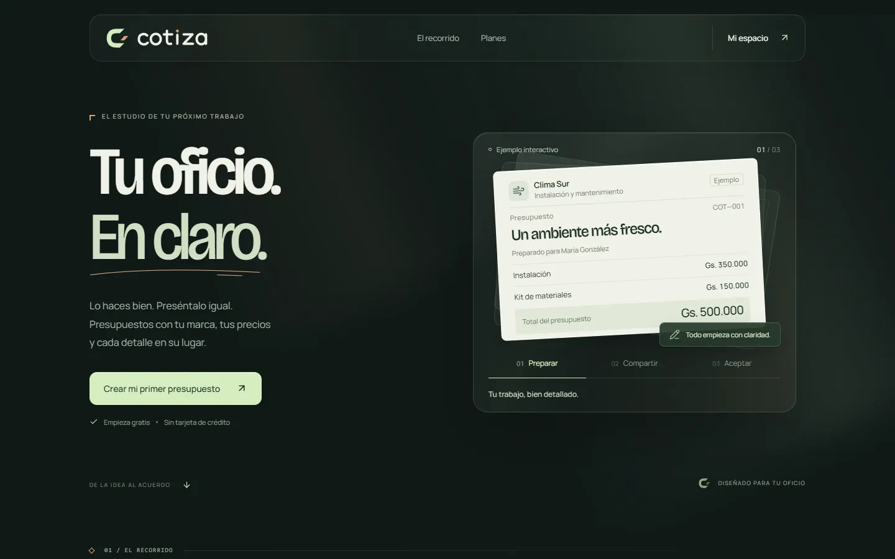

# Cotiza

[](https://github.com/nandres/cotiza/actions/workflows/ci.yml)

Presupuestos para quien trabaja por su cuenta. Arma el presupuesto con tus servicios y precios, compartilo por WhatsApp o en PDF y mirá si el cliente lo aceptó o pidió cambios.

**En línea:** https://cotiza-nine.vercel.app



> **Software propietario.** Ver [LICENSE](LICENSE).

## Qué hace

- **Presupuestos** con tu marca, tus servicios y tus precios.
- **Clientes y servicios guardados** para el siguiente presupuesto.
- **Enlace público** para que el cliente responda sin crear una cuenta; la respuesta queda junto a la propuesta.
- **PDF** desde el navegador.
- **Cuentas** con confirmación de correo y recuperación de contraseña.

Los cobros están desactivados: todas las cuentas tienen 3 presupuestos nuevos por mes y el plan Profesional todavía es una propuesta.

## Stack

| Capa | Tecnología |
|---|---|
| Aplicación | Next.js, React y TypeScript |
| Base de datos | PostgreSQL, con migraciones SQL propias |
| Cuentas | Supabase Auth |
| Publicación | Vercel |

## Cómo está resuelto

- Cada petición de datos corre en una transacción con un bloqueo por usuario, para que la cuota no dependa de una lectura concurrente.
- Los datos están aislados por usuario. El servidor verifica la sesión con Supabase.
- `npm run db:migrate` aplica `migrations/` en orden, registra el SHA256 de cada archivo y rechaza cambios en los que ya se aplicaron.

## Correrlo

Requiere Node.js 24 y un proyecto de Supabase.

```bash
npm ci
cp .env.example .env.local
npm run db:migrate
npm run dev
```

`DATABASE_URL` es privada y solo la usa el servidor. En Supabase Auth hay que dejar activa la confirmación de correo y registrar `/auth/callback` como URL de redirección.

```bash
npm run typecheck
npm test
npm run build
```

Hecho por **Marcos Arellano** · [marcos-arellano.vercel.app](https://marcos-arellano.vercel.app)
